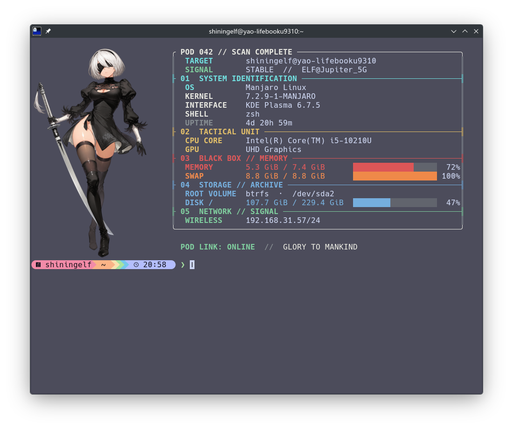

# animate-fastfetch

Character themed Fastfetch configurations. Each character lives in its own folder under `animate/` and can be selected with Fastfetch's `--config` option.

## Install

```sh
git clone https://github.com/shiningelf/animate-fastfetch.git
cd animate-fastfetch
./install.sh
```

`install.sh` is a convenience script that copies both character folders into `~/.config/fastfetch/animate/`. You can also install them manually from the repository root:

```sh
mkdir -p ~/.config/fastfetch/animate
cp -R animate/nezuko animate/2b ~/.config/fastfetch/animate/
```

Choose a character by passing its config file:

```sh
fastfetch --config ~/.config/fastfetch/animate/nezuko/config.jsonc
fastfetch --config ~/.config/fastfetch/animate/2b/config.jsonc
```

`--config` expects a config file, so include `config.jsonc` after the character folder. To install somewhere else, pass a destination to the installer:

```sh
./install.sh /path/to/fastfetch/animate
```

## zsh startup and cursor

If Fastfetch hides the terminal cursor after it runs, append `printf '\e[?25h'` to the command in `~/.zshrc` to show it again:

```sh
fastfetch --config /home/shiningelf/.config/fastfetch/animate/2b/config.jsonc ; printf '\e[?25h'
```

Replace the config path with the character you want to show at startup.

## Characters

### Nezuko

A custom two-column panel with a transparent portrait, Japanese quote, system and hardware cards, live network details, and a Demon Slayer footer mark.


Requires Fastfetch 2.69+, Python 3, a Nerd Font, a Kitty graphics capable terminal, NetworkManager (`nmcli`), and `ip`.

### 2B

A POD 042 scan console layout with a transparent 2B portrait on the left and color-coded system identification, tactical unit, black box memory, storage archive, and network signal sections on the right. Memory and disk usage use colored bars; the panel also shows GPU, live `user@hostname`, the connected Wi-Fi SSID and only the active wireless and wired IPv4 rows. The portrait uses Kitty graphics protocol, so use a compatible terminal.


