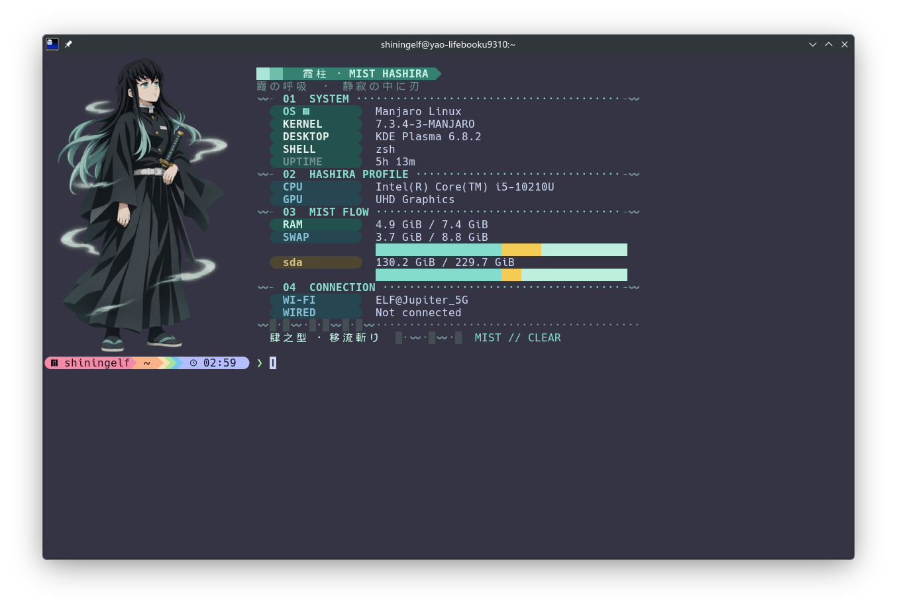

# animate-fastfetch

Character themed Fastfetch configurations. Each character lives in its own folder under `animate/` and can be selected with Fastfetch's `--config` option.

## Install

```sh
git clone https://github.com/shiningelf/animate-fastfetch.git
cd animate-fastfetch
./install.sh
```

`install.sh` is a convenience script that copies both character folders into `~/.config/fastfetch/animate/`. You can also install them manually from the repository root:

```sh
mkdir -p ~/.config/fastfetch/animate
cp -R animate/nezuko animate/2b animate/muichiro ~/.config/fastfetch/animate/
```

Choose a character by passing its config file:

```sh
fastfetch --config ~/.config/fastfetch/animate/nezuko/config.jsonc
fastfetch --config ~/.config/fastfetch/animate/2b/config.jsonc
fastfetch --config ~/.config/fastfetch/animate/muichiro/config.jsonc
```

`--config` expects a config file, so include `config.jsonc` after the character folder. To install somewhere else, pass a destination to the installer:

```sh
./install.sh /path/to/fastfetch/animate
```

## zsh startup and cursor

If Fastfetch hides the terminal cursor after it runs, append `printf '\e[?25h'` to the command in `~/.zshrc` to show it again:

```sh
fastfetch --config /home/shiningelf/.config/fastfetch/animate/2b/config.jsonc ; printf '\e[?25h'
```

Replace the config path with the character you want to show at startup.

## Characters

### Nezuko

A custom two-column panel with a transparent portrait, Japanese quote, system and hardware cards, live network details, and a Demon Slayer footer mark.


Requires Fastfetch 2.69+, Python 3, a Nerd Font, a Kitty graphics capable terminal, NetworkManager (`nmcli`), and `ip`.

### 2B

A POD 042 scan console layout with a transparent 2B portrait on the left and color-coded system identification, tactical unit, black box memory, storage archive, and network signal sections on the right. Memory and disk usage use colored bars; the panel also shows GPU, live `user@hostname`, the connected Wi-Fi SSID and only the active wireless and wired IPv4 rows. The portrait uses Kitty graphics protocol, so use a compatible terminal.


#### Replace the 2B portrait

The default portrait is `animate/2b/2b.png`. To switch to the alternate `rule34.png`, edit the `logo.source` value in `animate/2b/config.jsonc`:

```jsonc
"source": "~/.config/fastfetch/animate/2b/rule34.png"
```

Keep `width: 28` and `height: 25` to preserve the current layout footprint. Then run `./install.sh` again, or manually copy the updated `animate/2b/` folder into `~/.config/fastfetch/animate/2b/`. `background.png` is included as an optional terminal wallpaper; Fastfetch does not apply it automatically, so set it in your terminal's background settings.

### Muichiro Tokito

A mist themed Hashira console with a transparent Muichiro portrait, rounded color-backed information pills, flowing mist dividers, live system and hardware details, and a Mist Breathing footer. RAM and disk bars show the used fraction in mint through 50%, yellow from 50% to 80%, and orange-red above 80%, with the unused fraction in light mint; swap is shown separately. The panel reads the active Wi-Fi SSID and wired IPv4/router details. The portrait uses Kitty graphics protocol, so use a compatible terminal and Nerd Font.


