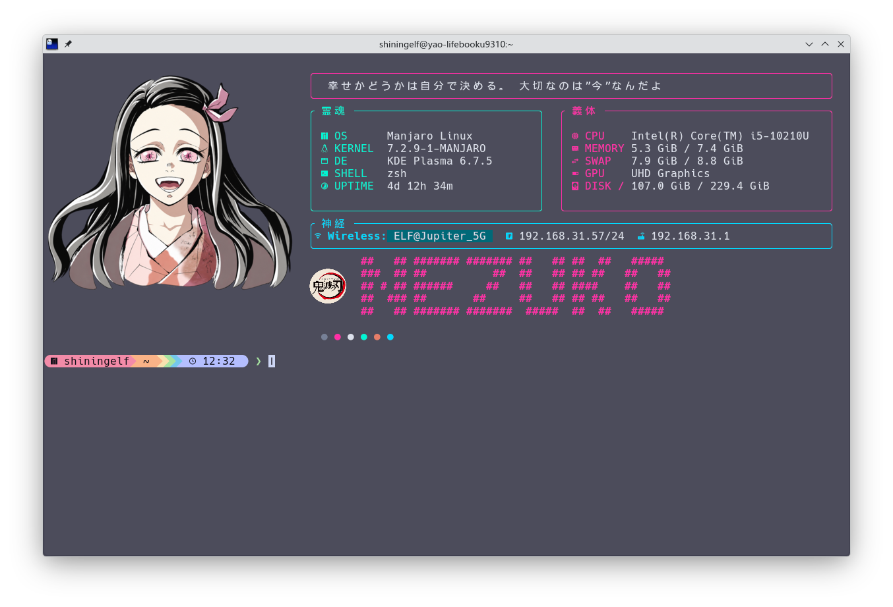

# Nezuko Fastfetch Layout

[English](#english) | [简体中文](#简体中文)

## English

A custom Fastfetch layout featuring a transparent Nezuko portrait, Japanese quote, system and hardware panels, live wireless/wired network details, and a Demon Slayer footer mark beside an ASCII `NEZUKO` wordmark.



## Requirements

- Fastfetch **2.69 or newer**. This theme was tested with Fastfetch 2.69.0; version 2.71 or newer is not required.
- Python 3
- A Nerd Font for the icons
- A terminal with Kitty graphics support for the PNG images (tested with Ghostty and Konsole)
- NetworkManager (`nmcli`) and `ip` for live network details

## Install

```sh
mkdir -p ~/.config/fastfetch
cp config.jsonc ~/.config/fastfetch/nezuko-layout.jsonc
cp data.jsonc nezuko-panel.py kimetsunoyaiba-footer.png ~/.config/fastfetch/
cp -n nezuko-transparent.png ~/.config/fastfetch/nezuko-transparent.png
fastfetch --config ~/.config/fastfetch/nezuko-layout.jsonc --show-errors
```

The `cp -n` command keeps an existing portrait file. The theme uses a dedicated config file and does not replace Fastfetch's default config.

To use this layout when zsh starts, add this line to `~/.zshrc`:

```sh
fastfetch --config ~/.config/fastfetch/nezuko-layout.jsonc
```

## Layout

The left side shows the transparent portrait. The right side contains the Japanese quote, system and hardware cards, and a network panel.

---

## 简体中文

一个面向 Arch Linux 及其衍生系统的 Fastfetch 主题：左侧显示祢豆子透明头像，右侧显示系统、硬件和网络信息，并搭配日文台词与《鬼灭之刃》底部标记。

## 预览


## 运行要求

- Fastfetch 2.69 或更新版本。本主题已在 2.69.0 上运行验证，不要求 2.71 及以上版本。
- Python 3
- 支持 Nerd Font 图标的字体
- 支持 Kitty 图形协议的终端，用于显示 PNG 图片；Ghostty 和 Konsole 已验证
- NetworkManager 的 `nmcli` 和 `ip` 命令，用于读取网络信息

## 安装

在主题文件所在目录执行：

```sh
mkdir -p ~/.config/fastfetch
cp config.jsonc ~/.config/fastfetch/nezuko-layout.jsonc
cp data.jsonc nezuko-panel.py kimetsunoyaiba-footer.png ~/.config/fastfetch/
cp -n nezuko-transparent.png ~/.config/fastfetch/nezuko-transparent.png
fastfetch --config ~/.config/fastfetch/nezuko-layout.jsonc --show-errors
```

配置安装到独立的 `nezuko-layout.jsonc`，不会替换 Fastfetch 默认配置。`cp -n` 会在目标头像文件已存在时保留原文件。

如需在 zsh 启动时自动显示，可在 `~/.zshrc` 中加入：

```sh
fastfetch --config ~/.config/fastfetch/nezuko-layout.jsonc
```

## 主题内容

- 左侧为祢豆子透明头像；右侧包括日文台词、系统卡片、硬件卡片和网络卡片。
